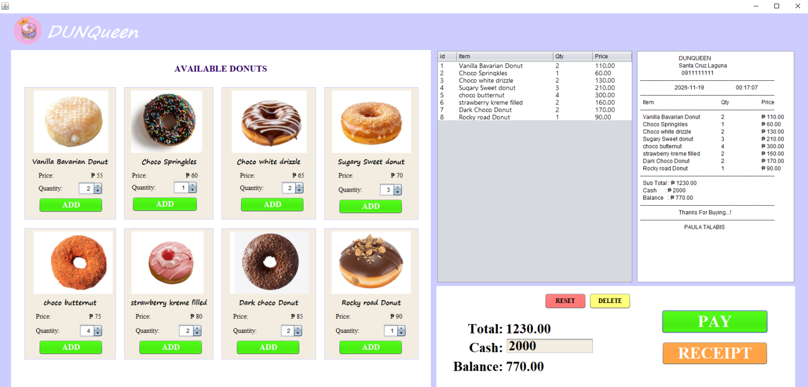

# DunQueen – Point of Sale (POS) System

## Description

Dunking is a basic Point of Sale (POS) system developed using Java in NetBeans IDE as part of an academic programming project.

The system was designed to demonstrate the fundamental processes of a Point of Sale application, including handling customer orders, calculating purchases, and supporting basic sales transactions.

This project focuses on applying programming concepts, designing a user-friendly interface, and understanding how computerized POS systems can simplify everyday business transactions.

## Technologies Used

- Java
- Apache NetBeans IDE
- Java Swing (GUI, if applicable)

## System Screenshot

## Project Information

**Project Name:** Dunking

**Project Type:** Academic Programming Project

**Development Environment:** Apache NetBeans IDE

**Programming Language:** Java
